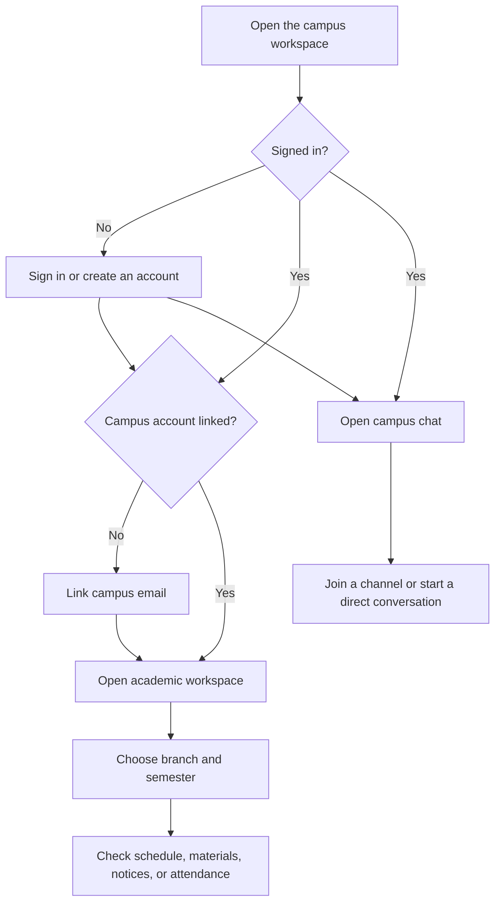

## What It Is

IIIT NR Workshop is a campus web app for organizing parts of student life in one place. Its academic workspace brings together course schedules, study materials, attendance tracking, notices, events, and student profiles. A separate campus chat area supports group channels and direct conversations.

The app is built for IIIT Naya Raipur, while some screens can be configured to display other campus and course details.

## Who It's For

- **Students** who want to check academic information, keep track of attendance, find course materials, and talk with campus peers.
- **Teachers and campus staff** who want to understand the academic and communication tools available in the workspace.
- **Other branches and outside readers**, including recruiters, who want a clear overview of the project. The app does not include a recruiter-specific workflow.

## Features

- **Campus chat:** Group channels and one-to-one conversations, online-member presence, message editing and deletion, and file attachments. Audio/video call controls are also present; see **UNVERIFIED** below for the part that depends on the separate service.
- **Academic workspace:** Branch and semester timetables, calendar, subject summaries, assignments, practical work, exam schedules, notices, events, and personal tasks.
- **Lecture materials:** Browse, search, and filter listed materials by category and subject; star items and use the upload action. The current interface is organized around branch and semester, not a year-wise library.
- **Attendance tracker:** Add a course, enter class counts, and mark classes attended or missed. This is a student-maintained tracker, not an official attendance record.
- **Student profile:** Maintain profile details, a photo, skills, and links such as GitHub or LinkedIn.
- **Campus information:** View a faculty directory and a lost-and-found list.

There is no separate discussion-forum feature or borrowing-and-lending workflow in the current app. Group chat is the available place for campus conversations; a year-wise library and borrowing/lending could be considered for future work.

Some academic screens begin with sample records. Some data is saved in the browser, and selected sections also request data from a separate campus service. Availability and persistence therefore depend on the service and feature; see **UNVERIFIED** below.

## How It Works

This diagram shows the main student path through the screens. Academic access checks whether a campus account is linked; a personal account is directed to link a campus email before using Academics.



## Tools Used

| Tool | What it is | Why chosen |
| --- | --- | --- |
| Next.js | A website framework, like a building plan that organizes pages and server features. | It powers the app's pages, navigation, and build process. |
| React | A screen-building library, like reusable blocks for assembling interface pieces. | The workspace screens and interactive controls are built as React components. |
| TypeScript | JavaScript with extra checks, like labeled forms that catch mismatched entries. | It helps describe and check the user, course, message, and file data used by the app. |
| Tailwind CSS | A styling toolkit, like a set of labeled paint and layout tools. | It is used throughout the screens to control layout, spacing, and appearance. |
| Socket.IO client | A live-connection tool, like a phone line that stays open for new updates. | The chat uses it to receive and send live messages and presence updates. |
| LiveKit | Audio/video room tools, like the equipment and room link for a group call. | The project includes call screens and LiveKit connection code for campus chat. |
| pnpm | A package installer, like a storekeeper organizing workshop supplies. | The project declares pnpm and includes a lockfile so installations can use recorded package versions. |
| Docker | A way to pack an app and its runtime, like putting a kit in a lunchbox for consistent use. | A Dockerfile and Compose configuration are included for container-based builds and runs. |

## Folder Structure

```text
src/
	app/                 Pages and route layouts: login, setup, marketing, workspace
	components/          Shared interface pieces, including app navigation and profile menu
	features/
		academics/         Academic screens, data, hooks, and service calls
		auth/              Sign-in, account, and session handling
		chat/              Chat screens, live connection, and call interface
		dashboard/         Main workspace dashboard
		admin/             Campus administration screens
		marketing/         Public product pages
		setup-wizard/      Initial setup screens
	lib/                 Shared API, access-permission, and socket helpers
public/                Images, icons, illustrations, and videos used by the app
```

## How to Run

The container build uses Node.js 20, and the project declares pnpm 12.4.1. Use a Node.js 20 installation and Corepack, which comes with Node.js, to enable the declared package manager.

From the project folder, run:

```powershell
corepack enable
pnpm install --frozen-lockfile
pnpm dev
```

Then open [http://localhost:3000](http://localhost:3000).

These commands start the web app. The project also connects to a separate campus service for some account, academic, chat, and call features. By default, the shared API client points to the hosted campus API; the API and chat address can be changed with `NEXT_PUBLIC_API_URL` and `NEXT_PUBLIC_WS_URL`. In local development, the Next.js configuration routes `/api/...` requests to `http://localhost:4000/api/...`. This repository does not include that separate service, so starting the web app alone does not guarantee that live or account-backed features will connect.

The available package commands are `pnpm dev` (development server), `pnpm build` (build the app), `pnpm start` (the package's production-start script), and `pnpm lint` (run ESLint checks). **Production start note:** `pnpm start` invokes `next start`, but this project selects standalone output in `next.config.ts`; Next.js warns that `next start` is not supported with that setting. The included Dockerfile instead runs the generated standalone server with `node server.js`. The Compose file expects a `.env` file, which is not included in this repository.

## Future Scope

- Add year-wise browsing for the campus study library.
- Add a structured borrow-and-lend area for student items or resources.
- Add a dedicated community discussion board alongside chat.
- Connect and verify live service behavior for calls and campus data in a configured deployment.

These are future possibilities, not claims about features currently provided.

## Glossary

- **API:** A service counter that one part of an app uses to request information or ask another part to do something.
- **Backend:** The behind-the-scenes service that handles requests and may manage shared campus information; think of it as the college office behind the reception desk.
- **Branch and semester:** A student's field of study and current term, like choosing the correct department and page in a course planner.
- **Browser storage (`localStorage`):** A small notebook kept by the web browser on one device. It can remember some settings or sample entries, but it is not the same as a shared college register.
- **Corepack:** A tool that selects the package-manager version for a project, like a key ring that opens the correct workshop cabinet.
- **Container (Docker):** A packed lunchbox for software: the app and its required runtime are packaged together so they can be run in a consistent environment.
- **Docker Compose:** A tool that starts configured containers, like a checklist for setting up several pieces of equipment together.
- **Deployment:** Putting a finished app on a server for people to use, like opening the campus service desk after setup.
- **Environment variable:** A setting supplied when the app runs, like a note attached to a work order that tells a tool which service address to use.
- **ESLint / lint:** A code checker, like a proofreader that flags style and common mistakes. `pnpm lint` runs it.
- **Framework (Next.js):** A set of building plans and ready-made structure for a website, like a standard campus building plan.
- **Frontend:** The part of the app a person sees and uses, like the reception desk and forms.
- **Lockfile:** A list of the exact package versions for the project, like an inventory sheet that helps restock the same supplies.
- **Live connection (Socket.IO):** A phone line kept open so new chat messages can arrive without repeatedly asking for updates.
- **Mermaid:** A way to draw a diagram from text instructions, like writing directions that a map-maker turns into a route map.
- **Package / dependency:** A prebuilt software component the project uses, like a supplied tool in a workshop.
- **Package manager (pnpm):** The tool that fetches and organizes those software components, like a storekeeper tracking workshop supplies.
- **Real-time:** An update delivered as it happens, similar to hearing a new announcement over a live intercom.
- **Runtime (Node.js):** The environment that runs the website's JavaScript tools, like the engine that lets a machine operate.
- **Server:** A computer or service that provides information or app features to other computers, like a campus office serving requests from students.
- **TypeScript:** A version of JavaScript with extra checks about what kind of information is expected, like labeled forms that catch mismatched entries.
- **UNVERIFIED:** Something the available project files do not let us confirm, like a notice awaiting confirmation from the office.

## Verification Notes

**UNVERIFIED**

- The separate campus API and chat service are not included in this repository. Their uptime, live data, authentication checks, and data retention could not be verified here.
- The chat call interface requests a LiveKit room token from the separate service. A working audio/video call could not be confirmed from the frontend code alone.
- Sample academic records are present in the project. Their accuracy and whether a deployment replaces them with current IIIT Naya Raipur records must be confirmed with the campus service owner.
