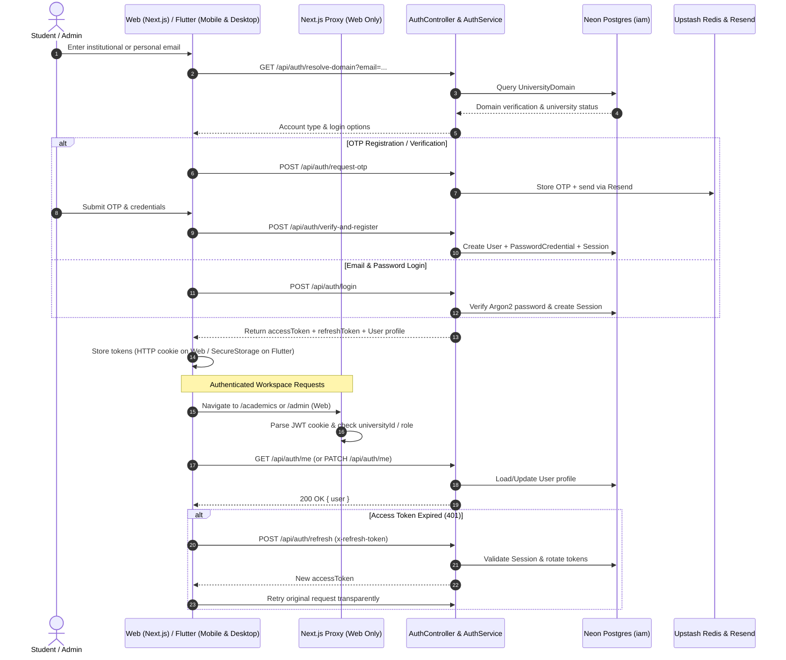
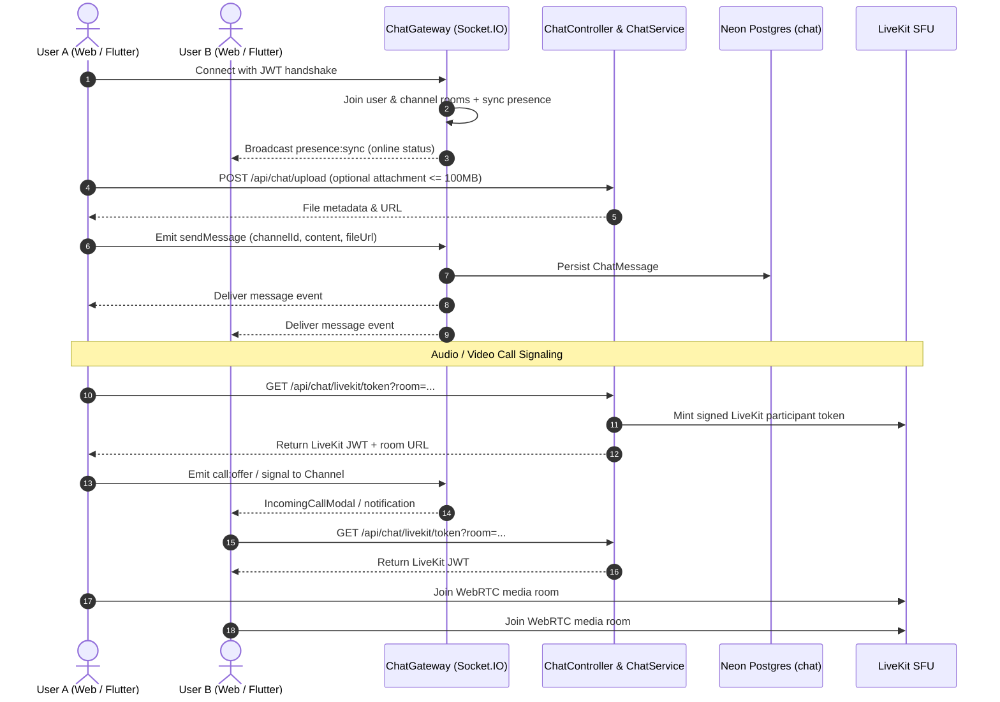
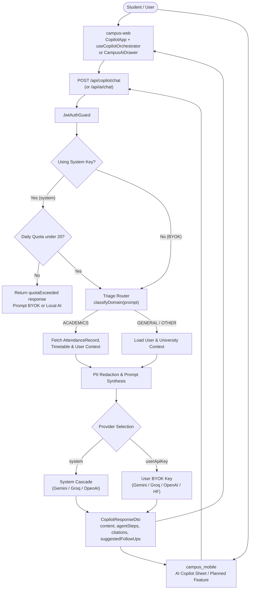

# Runtime Flows & Sequence Diagrams (`campus-web`)

Key client-server interaction flows for authentication, Socket.IO/LiveKit real-time features, and AI Copilot orchestration.

- Mermaid sources: [auth-sequence.mmd](../diagrams/auth-sequence.mmd), [realtime-chat-livekit.mmd](../diagrams/realtime-chat-livekit.mmd), [ai-copilot-flow.mmd](../diagrams/ai-copilot-flow.mmd)

## 1. Authentication & Edge Proxy Gate

## 2. Real-Time Chat & LiveKit Video Calls

## 3. AI Copilot Orchestration

