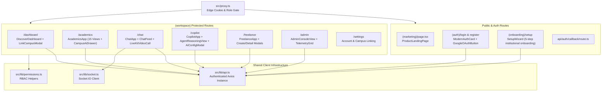
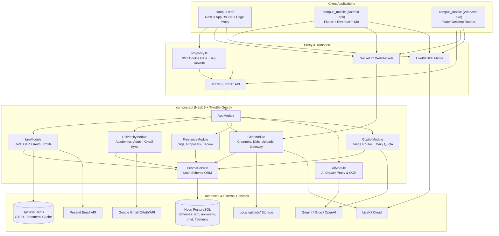

# System & Feature Capsule Overview (`campus-web`)

Visual overview of how **Campus Web** (`Next.js` App Router + `src/proxy.ts` + feature capsules) connects to **Campus API**.

- Mermaid sources: [system-architecture.mmd](../diagrams/system-architecture.mmd), [campus-web-capsules.mmd](../diagrams/campus-web-capsules.mmd)

## 1. Web App Route Groups & Feature Capsules

## 2. Full Platform Integration

